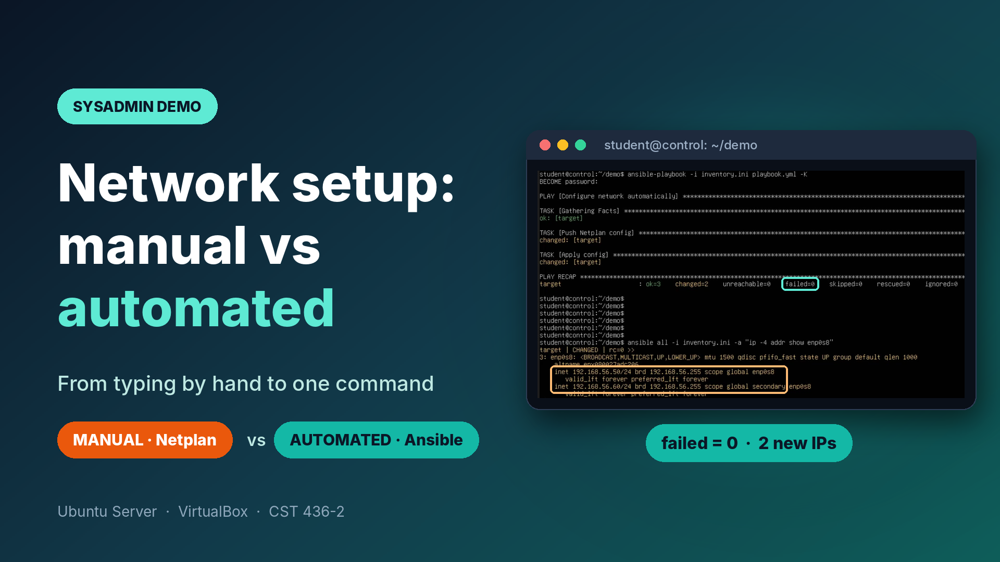
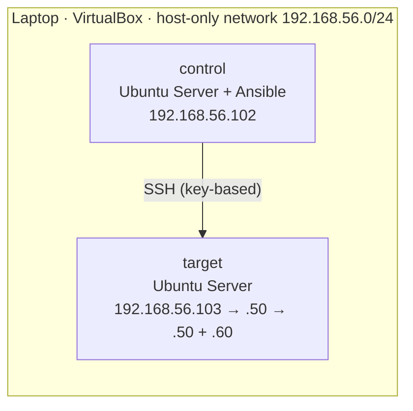

# Network Automation Lab

Configuring a server's network **by hand with Netplan**, then doing the same job **automatically with Ansible**, from a second machine and without logging in to the server.

[](https://lnkd.in/p/gkB9Xt8K)

*Click the image to watch the 2-minute demo on LinkedIn (captions explain each step), or [download the video](media/demo.mp4?raw=1).*

Built for **CST 436-2 System Administration and Maintenance**, BSc (Hons) Computer Science & Technology, Uva Wellassa University of Sri Lanka.

## What the demo shows

| | Manual (Part 1) | Automated (Part 2) |
|---|---|---|
| Where you work | On the server itself | On a separate control node |
| Tool | Netplan | Ansible playbook (pushes a Netplan file) |
| What changes | `.103` (DHCP) → `.50` (static) | `.50` → `.50` + `.60`, new DNS servers |
| Effort for 100 servers | 100 logins, 100 edits | The same one command |

## Lab setup

Two Ubuntu Server VMs in VirtualBox on one laptop. Each VM has two network adapters: **NAT** for internet and **Host-only** for a private lab network (`192.168.56.0/24`).



The `target` VM is a full clone of `control` with new MAC addresses, a new hostname and a new machine ID.

## Files

| Path | Purpose |
|---|---|
| `netplan/99-static.yaml` | Part 1: static IP `.50`, written by hand on the target |
| `netplan/50-dhcp.yaml` | Clean DHCP config for the cloned VM (see Troubleshooting) |
| `netplan/60-internet.yaml` | Internet on the NAT adapter after an offline install |
| `ansible/inventory.ini` | Which machine Ansible manages, and as which user |
| `ansible/playbook.yml` | Copies the new Netplan file to the target and applies it (only when the file changed) |
| `ansible/99-static.yaml` | The settings the playbook pushes: `.50` + `.60` and new DNS |
| `media/` | Demo video and thumbnail |

## Run it yourself

**Part 1: manual (on the target)**

```bash
ip -4 a show enp0s8                                  # before: 192.168.56.103
sudo nano /etc/netplan/99-static.yaml                # paste netplan/99-static.yaml
sudo chmod 600 /etc/netplan/99-static.yaml
sudo netplan apply
ip -4 a show enp0s8                                  # after: 192.168.56.50
```

**Part 2: automated (on the control node)**

```bash
sudo apt install -y ansible
ssh-keygen                                           # accept the defaults
ssh-copy-id student@192.168.56.50                    # password-less SSH to the target

cd ansible
ansible all -i inventory.ini -m ping                 # expect "pong"
ansible-playbook -i inventory.ini playbook.yml -K    # -K asks for the target's sudo password
ansible all -i inventory.ini -a "ip -4 addr show enp0s8"   # expect .50 and .60
```

The playbook keeps `.50` and only *adds* `.60`, so the SSH session Ansible is using never drops.

**Reset the target for another run**

```bash
sudo rm /etc/netplan/99-static.yaml && sudo reboot   # back to DHCP (.103)
```

## Troubleshooting (problems I actually hit)

| Symptom | Cause | Fix |
|---|---|---|
| Ubuntu install stuck for hours at "installing kernel"; a green turtle icon in VirtualBox | Windows Hyper-V was running underneath VirtualBox | Turn off Hyper-V, Virtual Machine Platform, Windows Hypervisor Platform and Memory Integrity; run `bcdedit /set hypervisorlaunchtype off`; restart. Install with the NAT cable unplugged so the installer works offline |
| `ping google.com`: temporary failure in name resolution | Offline install left the NAT adapter without a config | Add `netplan/60-internet.yaml` and `sudo netplan apply` |
| `rm /etc/machine-id` fails on the clone | Permission or file in use | `sudo truncate -s 0 /etc/machine-id && sudo systemd-machine-id-setup` |
| `netplan apply`: cannot find unique matching interface | The clone's installer config still matched the original VM's MAC addresses | Move the installer's file out of `/etc/netplan` and use `netplan/50-dhcp.yaml` |
| Ansible: `Could not match supplied host pattern` | Typo in the inventory group name | First line of `inventory.ini` must be exactly `[servers]` |
| Ansible: `Timeout waiting for privilege escalation prompt` | Newer Ubuntu ships `sudo-rs`, whose prompt Ansible did not recognise | On the target: `sudo update-alternatives --set sudo /usr/bin/sudo.ws` |
| Ansible: `Could not find or access '99-static.yaml'` | File saved as `.yml` | `mv 99-static.yml 99-static.yaml` |

## What I learned

- Automation trades a little setup for speed and consistency: the same playbook gives the same result on 1 machine or 1,000, with no typos.
- Order of Netplan files matters: `99-` overrides `50-`, so the static file wins.
- Plan changes so the connection you depend on survives them (add an IP before removing one).
- Cloning a VM copies more than files: MAC-based configs, hostnames and machine IDs all need attention.

## License

[MIT](LICENSE)

## Author

**Induwara Ihalavithana** · [Portfolio](https://induwara-ihalavithana.vercel.app) · [GitHub](https://github.com/InduwaraIhalavithana)
